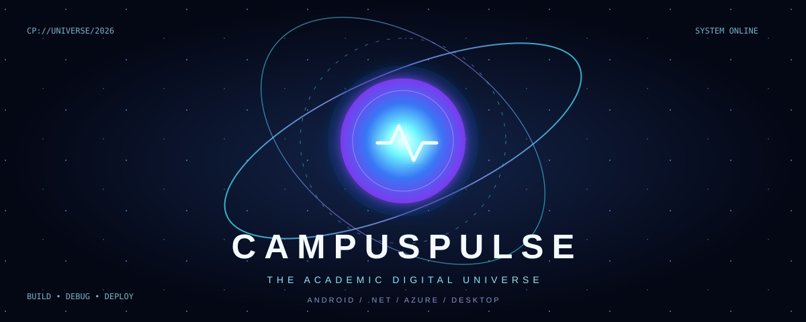
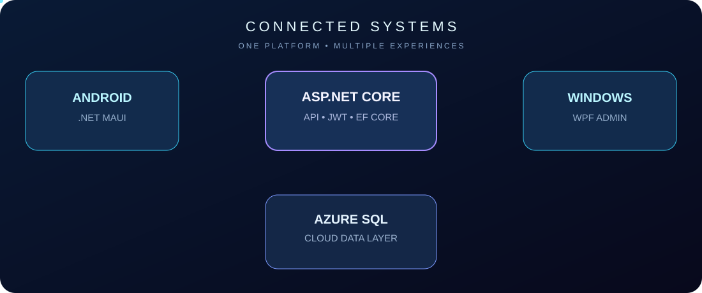

<div align="center">



### `> INITIALIZING THE NEXT GENERATION OF CAMPUS CONNECTIVITY_`

**One academic ecosystem. Three application layers. A universe of possibilities.**

   

  

[Explore the Universe](#-the-universe) · [System Architecture](#-the-system-orbit) · [Mission Log](#-mission-log) · [Roadmap](#-next-frontier)

</div>

---

## ✦ The Universe

**CampusPulse** is a full-stack academic management platform designed to connect students, lecturers and administrators through a shared digital ecosystem.

This project started with learning C# fundamentals in **2026** and grew into an integrated Android, desktop and cloud application. The experience spans authentication, API development, data persistence, deployment, and real-world debugging.

<table><tr><td width="33%" align="center"><h3>◈ STUDENT PORTAL</h3><strong>.NET MAUI · Android</strong><br/><br/>Registration, sign-in, student profile, timetable interface and QR scanner.</td><td width="34%" align="center"><h3>⬡ CLOUD CORE</h3><strong>ASP.NET Core · Azure</strong><br/><br/>REST API, JWT authorization, Entity Framework Core and Azure SQL.</td><td width="33%" align="center"><h3>⌘ ADMIN CONSOLE</h3><strong>WPF · Windows</strong><br/><br/>Academic administration, lecturer provisioning and student module enrolment workflows.</td></tr></table>

## ◎ The System Orbit

<div align="center"></div>

> **Architecture note:** The production API and Azure SQL are deployed. Android registration and sign-in have been verified against production. WPF-to-production integration and end-to-end enrolment workflows still require verification.

## ⚡ Technology Constellation

| Orbit | Stack |
| :-- | :-- |
| **Mobile** | C#, .NET MAUI, Android |
| **Desktop** | WPF, C# |
| **Backend** | ASP.NET Core Web API, .NET 10 |
| **Identity** | JWT authentication, role-based authorization, password hashing |
| **Data** | Entity Framework Core, SQL Server, Azure SQL Database |
| **Cloud** | Azure App Service |
| **Tooling** | Visual Studio, PowerShell, Git, GitHub |

## ◉ Mission Log

| System check | Status |
| :-- | :-- |
| Production API deployed to Azure | ✅ Verified |
| Azure SQL connected | ✅ Verified |
| New student registration from Android | ✅ Verified |
| Student sign-in | ✅ Verified |
| Student profile retrieval | ✅ Verified |
| Timetable screen opens | ✅ Verified — no modules enrolled yet |
| QR scanner camera opens | ✅ Verified — attendance flow not yet tested |
| Admin production enrolment | 🟡 Pending verification |
| Populated timetable | 🟡 Pending enrolment and testing |
| End-to-end QR attendance | 🟡 Pending verification |

## ◇ Beyond Localhost

> **The breakthrough wasn't getting the app to compile. It was watching a newly registered student sign in on a physical Android device while the app communicated with a live Azure API and database.**

The route to that milestone included production HTTP 500 errors, database connection timeouts, missing configuration, registration failures and a QR camera that initially refused to open. Each issue became an opportunity to learn about deployment, observability, environment configuration and reliable troubleshooting.

## ⌁ Launch Protocol

```bash
git clone <YOUR-REPOSITORY-URL>
cd <YOUR-REPOSITORY-DIRECTORY>
```

Open the appropriate solution in Visual Studio. Install compatible .NET, MAUI and Windows desktop workloads for the projects you plan to run. Restore NuGet packages and configure a **separate development database** and local environment secrets before starting the API.

> **Security boundary:** Never commit production connection strings, JWT signing keys, verification hash keys, signing keystores or real student information. The production database is not a development/test database.

The exact solution paths and launch commands should be added after verifying the repository layout.

## ✧ Next Frontier

- [ ] Verify WPF admin connection to the intended production API
- [ ] Verify student module enrolment end to end
- [ ] Verify populated timetables after enrolment
- [ ] Complete lecturer and QR attendance workflow testing
- [ ] Expand automated tests, resilience checks and production security review
- [ ] Capture sanitized screenshots and demo footage

## ◈ Visual Gallery

*Coming soon: Android student portal, WPF mission control and cloud deployment screenshots.*

---

<div align="center">

### `THE FUTURE IS BUILT, DEBUGGED, AND DEPLOYED.`

**CampusPulse** · Built with C#, .NET and Microsoft Azure

Created by **[Thabiso Nene](https://github.com/Blaqcodex)** · [Portfolio](https://thabisonene.com)

<sub>Animated SVGs are native GitHub-compatible visuals. They are decorative representations, not screenshots of the actual application.</sub>

</div>
